# MATLAB & Simulink – Control Engineering Projects

Coursework projects in automatic control from the Technical University of Cluj-Napoca (UTCN), covering the full control-engineering loop: **model a physical system → identify it from measured data → design a controller → validate it in simulation with realistic, non-ideal components.**

| # | Project | What it shows | Tools |
|---|---------|---------------|-------|
| 1 | [Buck converter: design, Simscape model and voltage control](01-buck-converter-power-electronics) | DC-DC converter sizing, a physical Simscape model with parasitics and tolerances, state-space model, controller synthesis, closed-loop validation | Simulink, Simscape Electrical, Control System Toolbox |
| 2 | [System identification](02-system-identification) | Least-squares regression, model-order selection, first-order and FIR models of a real DC motor from lab measurements, a 2-input nonlinear approximator | MATLAB |
| 3 | [Control system design](03-control-system-design) | Steady-state error analysis, disturbance rejection, P / PD / PI / PID design from time- and frequency-domain specs | MATLAB, Control System Toolbox |

```
.
├── 01-buck-converter-power-electronics/
│   ├── src/          MATLAB scripts + Simulink/Simscape models (.slx)
│   ├── lab3-hysteresis-modulator/   lab: buck converter driven by a hysteresis modulator
│   ├── ep2-hysteresis-modulator/    lab: the hysteresis modulator on its own
│   ├── figures/      simulation plots
│   ├── results/      saved simulation results (.mat)
│   └── reports/      written reports (PDF, in Romanian)
├── 02-system-identification/
│   ├── lab2-polynomial-regression/      script + data
│   ├── lab3-first-order-dc-motor/       script + recorded motor data
│   ├── lab4-correlation-fir/            script + recorded motor data
│   ├── project-2d-polynomial-fit/       script + data
│   ├── figures/
│   └── make_figures.m                   regenerates the figures below
└── 03-control-system-design/
    ├── src/          lab scripts
    ├── figures/
    └── make_figures.m                   regenerates the figures below
```

---

## 1. Buck converter – design, Simscape model and closed-loop voltage control

A step-down (buck) DC-DC converter designed from a specification, simulated at increasing levels of realism, and then given a voltage controller that holds the output at 20 V despite the losses of real components.

**Specification:** U<sub>in</sub> = 48 V → U<sub>out</sub> = 20 V, I<sub>out,max</sub> = 16 A, switching frequency 800 Hz, current ripple ≤ 35 % (5.6 A), voltage ripple ≤ 400 mV.

### 1.1 Sizing and ideal simulation (`proiect.m`, `tema1_figuri.m`, `simulare1.slx`)

| Quantity | Formula | Value |
|---|---|---|
| Duty cycle | μ = U<sub>out</sub>/U<sub>in</sub> | 0.4167 |
| Inductance | L = (U<sub>in</sub> − U<sub>out</sub>)·μ / (f<sub>s</sub>·ΔI<sub>L</sub>) | 2.604 mH |
| Capacitance | C = ΔI<sub>L</sub> / (8·f<sub>s</sub>·ΔU<sub>out</sub>) | 2187.5 µF |
| Load | R = U<sub>out</sub>/I<sub>out,max</sub> | 1.25 Ω |

Real catalogue parts were then selected (Hammond 195E30 inductor, 2.5 mH; Nichicon LGU 1800 µF capacitor; 90SQ045 Schottky diode). With the calculated values the simulation hits the specification exactly (ΔI<sub>L</sub> = 5.63 A, ΔU = 0.404 V); with the smaller real parts the ripple rises to 5.87 A / 0.511 V.

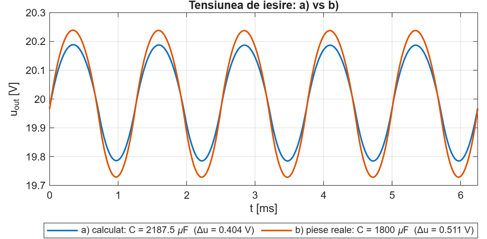

With a constant duty cycle (averaged model) the LC filter behaves as an under-damped 2nd-order system: **~19–22 % overshoot**, settling in about 20 ms.

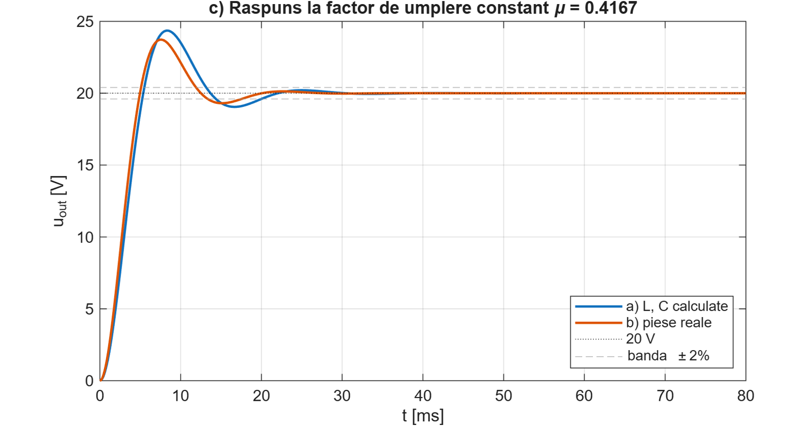

### 1.2 Physical Simscape model with parasitics and tolerances (`tema2_simscape.m`, `tema2_model.slx`)

The model is **built programmatically** from a script: a PNP switching transistor with a driver, a PWM generator subsystem, current and voltage sensors, diode, inductor, capacitor and load.

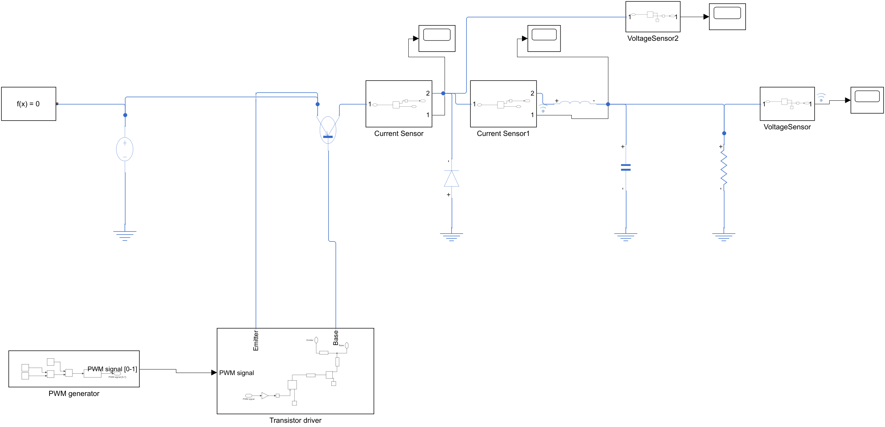

Starting from an ideal case, **one non-ideal effect is added at a time** so its effect can be isolated:

| Scenario | U<sub>out</sub> mean | ΔU<sub>out</sub> | ΔI<sub>L</sub> | Peak U<sub>out</sub> |
|---|---|---|---|---|
| a) ideal | 19.84 V | 0.401 V | 5.62 A | 24.33 V |
| b) nominal L, C | 19.83 V | 0.508 V | 5.87 A | 23.82 V |
| b.i) diode V<sub>f</sub> = 0.46 V | 19.63 V | 0.404 V | 5.67 A | 24.07 V |
| b.ii) capacitor ESR = 0.22 Ω | 19.86 V | **1.077 V** | 5.61 A | 23.69 V |
| b.iii) inductor DCR = 13 mΩ | 19.63 V | 0.401 V | 5.62 A | 24.01 V |
| b.iv) C at −20 % tolerance | 19.83 V | 0.610 V | 5.64 A | 22.82 V |
| b.v) L at −15 % tolerance | 19.83 V | 0.493 V | **6.90 A** | 25.26 V |

Main finding: the capacitor ESR dominates the output ripple (2.7× the ideal value, triangular instead of parabolic), while diode drop and inductor resistance lower the mean output voltage by ~0.2 V each.

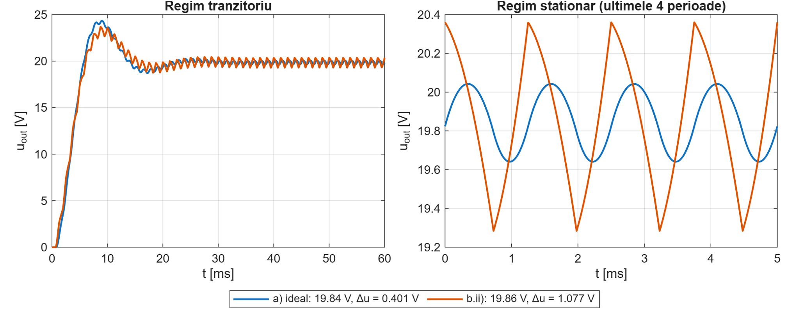

### 1.3 Controller design (`tema3.m`, `tema3_figuri.m`, `tema3_reglare.slx`)

- **State-space model** of the LC filter with load, x = [i<sub>L</sub>; u<sub>C</sub>], input = duty cycle:
  H<sub>p</sub>(s) = 1.0667·10⁷ / (s² + 444.4 s + 222 222), with ω<sub>n</sub> = 471 rad/s and ζ = 0.47 (open loop: 18.6 % overshoot).
- **Imposed closed-loop behaviour:** a 2nd-order system with σ = 0.1 % and t<sub>s</sub> = 20 ms (2 % band), giving ζ = 0.91 and ω<sub>n</sub> = 219.7 rad/s.
- **Direct synthesis:** H<sub>c</sub> = H<sub>p</sub>⁻¹ · H<sub>0</sub>/(1 − H<sub>0</sub>). The result has an integrator (zero steady-state error) and zeros that cancel the plant poles.
- **Simulink loop** with a Zero-Order Hold at the PWM period (1.25 ms) and duty-cycle saturation [0, 1].

| | Imposed | Obtained |
|---|---|---|
| Overshoot | 0.1 % (requirement ≤ 1 %) | **0.80 %** (ZOH delay) |
| Settling time (2 %) | 20 ms | **19.3 ms** |
| Steady state | 20 V | **20.00 V** |

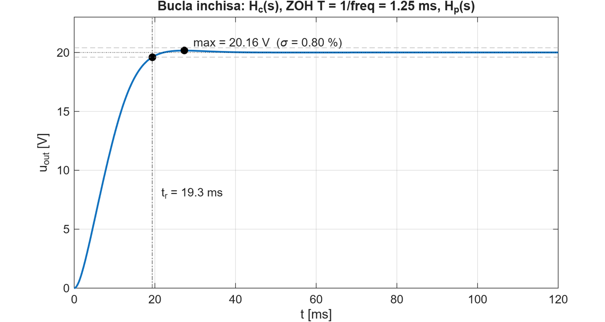

### 1.4 Validation on the full Simscape model (`tema3b.m`, `tema3b_simscape.slx`)

The controller was placed in the physical model from 1.2 with **all parasitics and worst-case tolerances applied at the same time** (L −15 %, C −20 %, ESR, DCR, diode V<sub>f</sub>), and compared with the open-loop converter:

| | Without controller | With controller |
|---|---|---|
| Mean output voltage | 19.45 V (−0.55 V error) | **20.01 V** |
| Overshoot (averaged voltage) | 13.8 % | **≈ 0 %** |
| Settling time | 11.6 ms | 23.8 ms |
| Steady-state duty cycle | 0.4167 (fixed) | 0.4250 (raised to compensate the losses) |

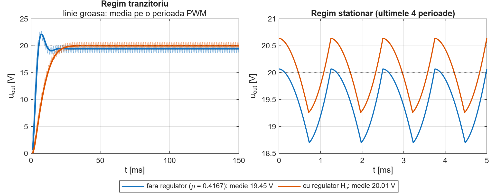

The integral action removes the error caused by the component losses, and the response becomes non-oscillatory.

### 1.5 Lab: buck converter driven by a hysteresis modulator (`lab3-hysteresis-modulator/`)

A second way to produce the switching signal: a hysteresis (sigma-delta) modulator instead of a fixed-frequency PWM. The converter (`lab3_buck_closed_loop.slx`) is written directly as state equations with integrator blocks (E = 24 V, 1/L = 10, 1/C = 100, 1/(RC) = 10). The output voltage is compared with a 14 V reference, and the error goes through a 0.5/(s+1) controller to the modulator.

In simulation the converter switches at about **124 Hz** and the output settles at **13.07 V** with 0.075 V ripple. The controller has no integrator, so ~0.9 V of steady-state error remains, as the static loop gain predicts (U = 28.8/2.2 ≈ 13.09 V).

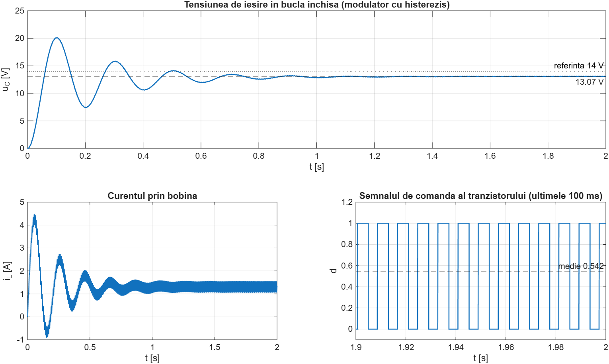

### 1.6 Lab: the hysteresis modulator on its own (`ep2-hysteresis-modulator/`)

`ep2_modulator.slx` isolates the modulator. The command passes through 0.5/(s+1). An integrator then accumulates the difference between the command and 10× the relay output, and a relay with ±0.01 hysteresis (output ±0.5, plus 0.5) produces the 0/1 switching signal.

The integrator ramps with slope c + 5 and c − 5 between the two thresholds, which gives:

- **average duty cycle** d = 0.5 + c/10, so the average output follows the command;
- **switching frequency** f = 125 − 5c² Hz, set by the hysteresis band rather than a carrier: 125 Hz at d = 0.5, and lower as d moves away from 0.5.

In the saved model the input is not connected, so the command is 0 and the output switches at 125 Hz with d = 0.50. `ep2_simulate.m` also applies a stepped command to the input, in memory only. The averaged duty cycle then tracks 0.5 + c/10 (e.g. 0.2165 measured vs. 0.2165 predicted at c = −2.84).

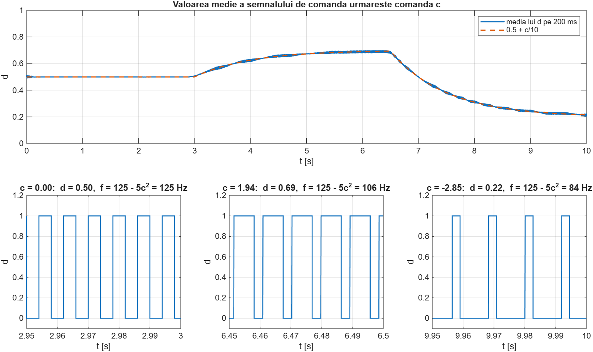

Full reports (in Romanian): [Part 1](01-buck-converter-power-electronics/reports/Tema1_Convertor_buck.pdf) · [Part 2](01-buck-converter-power-electronics/reports/Tema2_Model_Simscape.pdf) · [Part 3](01-buck-converter-power-electronics/reports/Tema3_Reglare.pdf)

---

## 2. System identification

Building models from data: linear-in-parameters regression, first-order process models and nonparametric (FIR) models of a **real DC motor** measured in the lab.

### 2.1 Polynomial regression and model-order selection (`lab2-polynomial-regression`)
A polynomial of degree *n* is fitted by least squares (θ = Φ \ y) on an identification set and evaluated on a separate validation set. The identification error keeps decreasing with the degree, but the validation error reaches its minimum at **degree 6**, after which the model starts to overfit.

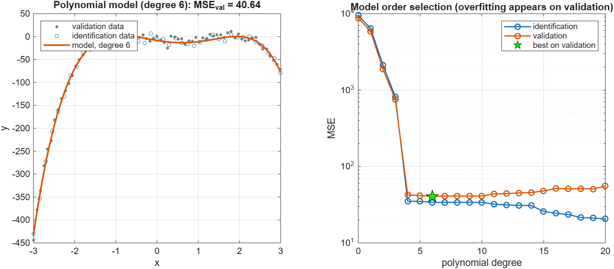

### 2.2 First-order model of a DC motor (`lab3-first-order-dc-motor`)
Speed measurements from a DC motor driven through a serial interface (Ts = 10 ms). The gain *K* comes from the steady state and the time constant *T* from the 63.2 % point (step test) or the 36.8 % decay point (impulse test). The step model, G(s) = 3245 / (0.07 s + 1), is validated on a different input sequence, including a negative step.

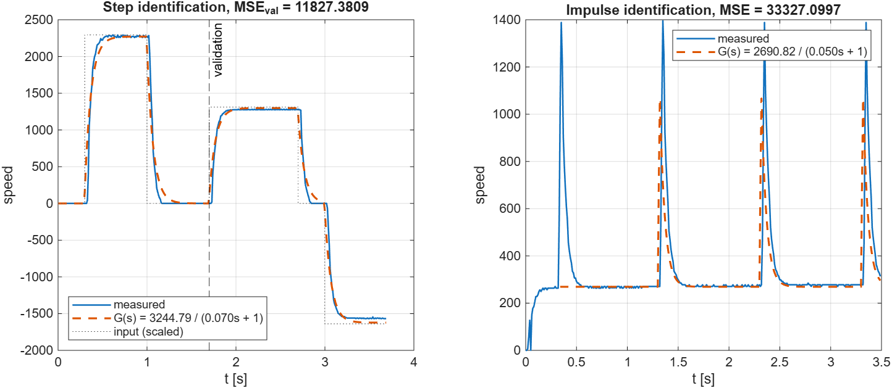

### 2.3 Correlation analysis – FIR model (`lab4-correlation-fir`)
The motor is excited with a random signal. From the auto-correlation r<sub>u</sub> and the cross-correlation r<sub>yu</sub>, a Wiener–Hopf system Φ·h = r<sub>yu</sub> is solved for an M-tap impulse response. With M = 60, the model follows the measurement on the random sequence and predicts the step in the validation segment.

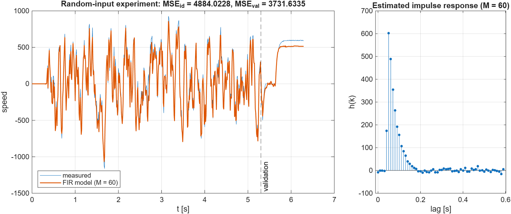

### 2.4 Project – approximating an unknown 2-input static function (`project-2d-polynomial-fit`)
A multivariate polynomial with all monomials x₁ⁱx₂ʲ, i + j ≤ m, fitted by least squares on a 41×41 identification grid and validated on a 71×71 grid with noise. The validation MSE levels off around m ≈ 6–7 (MSE ≈ 0.37, close to the noise floor). Above that, it rises again while the identification MSE keeps falling.

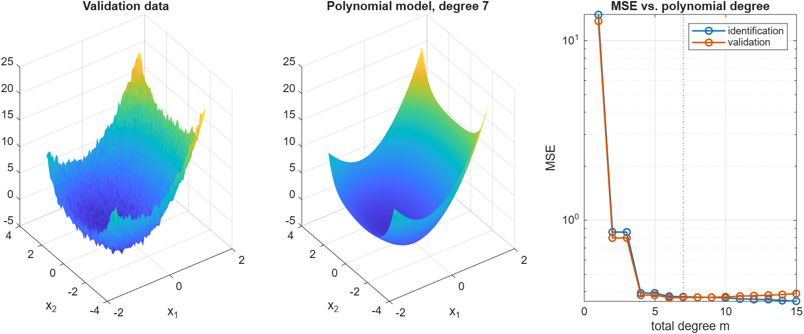

---

## 3. Control system design

Lab work on classical controller design with the Control System Toolbox.

### 3.1 Steady-state error (`lab02_steady_state_error.m`)
A P controller on a type-1 plant and a PI controller on a type-0 plant. Both give zero error to a step, and the ramp error equals 1/K<sub>v</sub> (0.083 and 0.1).

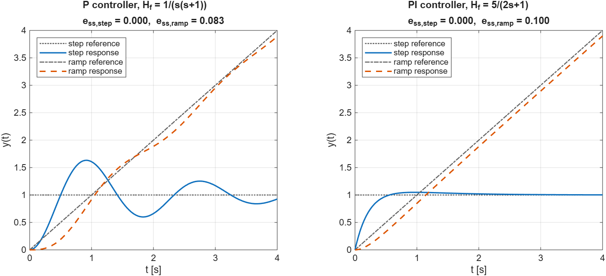

### 3.2 Disturbance rejection (`lab03_disturbance_rejection.m`)
Superposition of the reference and disturbance paths. The integral action of the PI controller brings the output back after every step in the disturbance.

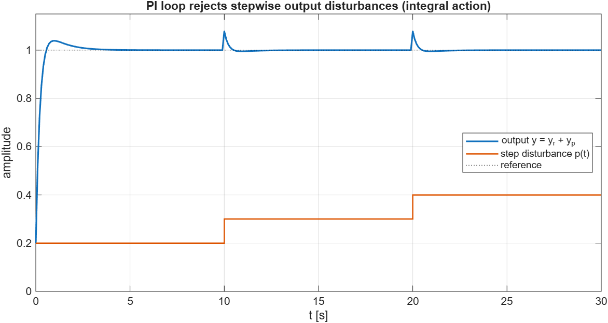

### 3.3 Controller design from performance specifications (labs 05–08)
- **lab05 / lab06:** analytic design from overshoot and settling time (2nd-order normal form) and direct synthesis with a **pole-zero dipole** that raises the velocity constant without changing the transient.
- **lab07 / lab08:** frequency-domain design on H<sub>f</sub>(s) = 3.5 / (s(0.5 s + 1)):
  - **P**, tuned for 7 % overshoot;
  - **PD** (lead), which cancels the plant pole and speeds the loop up for the same overshoot;
  - **PI** (lag), which raises the velocity constant c<sub>v</sub> from 1.25 to ≈ 7;
  - **PID** (lag + lead), which gives both.

| Controller | Overshoot | Settling time | c<sub>v</sub> [s⁻¹] | Phase margin |
|---|---|---|---|---|
| P   | 7.0 %  | 3.88 s  | 1.20  | 62° |
| PD  | 7.0 %  | 2.00 s  | 2.32  | 62° |
| PI  | 14.5 % | 13.1 s  | 6.60  | 57° |
| PID | 8.4 %  | 0.77 s  | 36.4  | 61° |

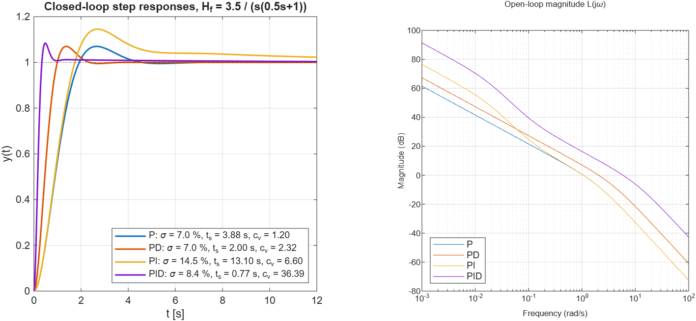

---

## Running the code

- **MATLAB R2026a** (the `.slx` models were saved with this release and won't open in older ones), **Simulink**, **Simscape / Simscape Electrical** (project 1) and the **Control System Toolbox**.
- **Project 1:** open `01-buck-converter-power-electronics/src` and run `tema1_figuri`, `tema2_simscape`, `tema3_figuri` or `tema3b`. Each script rebuilds its model, runs the simulation and writes the plots to `figures/` and the results to `results/`. The scripts build the `.slx` models themselves; the models are committed so they can also be opened directly.
- **Projects 2 and 3:** run `make_figures.m` in the project folder to regenerate every plot above from the stored data. The individual lab scripts are the original coursework. In project 2, the sections that acquire data from the motor call the lab's `DCMRun` hardware toolbox (not included); the recorded data is included, so the analysis sections run without it.
